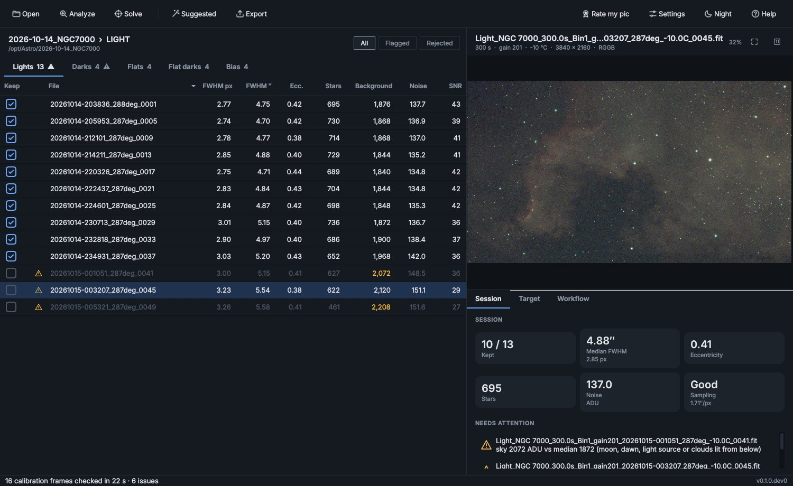
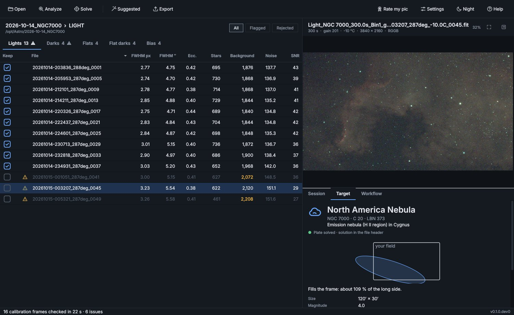
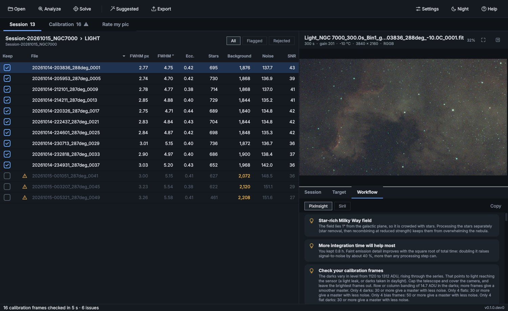
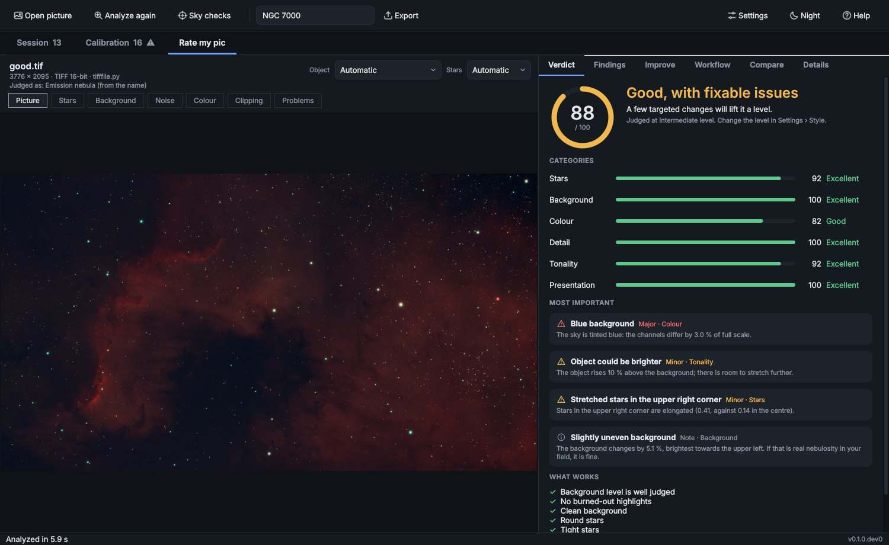
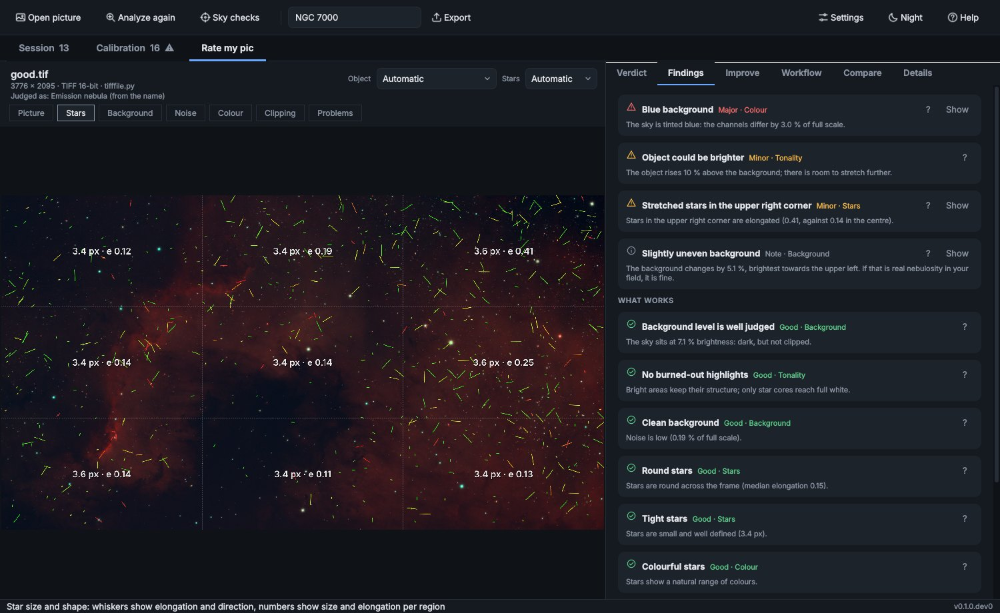
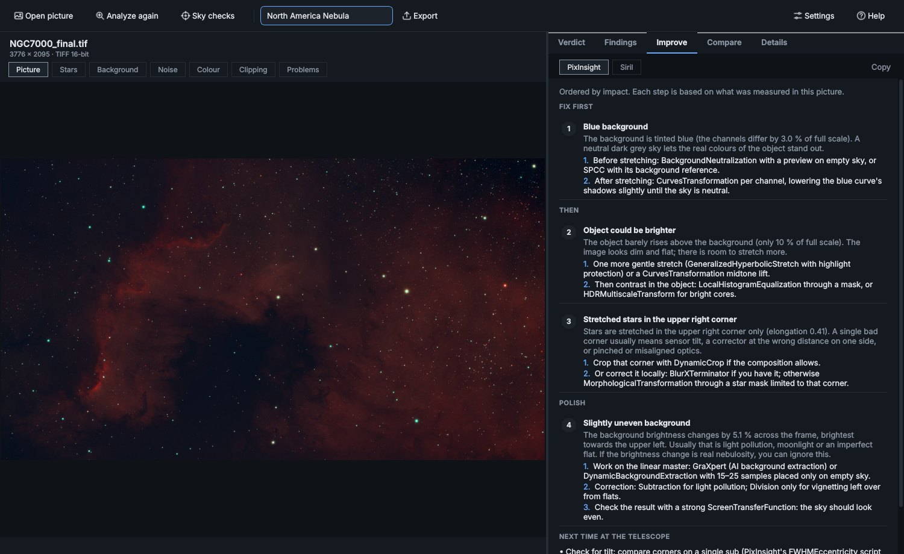

<p align="center">
  
</p>

<h1 align="center">Advanced Astrophoto Analyzer</h1>

<p align="center">
  <b>Know what your astro data is worth, and what to do with it.</b><br>
  Free analyzer and advisor for deep-sky astrophotography · Windows · macOS · Linux
</p>

<p align="center">
  Version <b>0.1.0.dev0</b> (development preview) ·
  <a href="https://github.com/Coffymonk/AdvAstro/releases">Download</a> ·
  <a href="https://github.com/Coffymonk/AdvAstro/releases">User manual (PDF, English and Swedish)</a>
</p>

Advanced Astrophoto Analyzer (AdvAstro for short) looks at your astro imaging data and tells
you, with your own numbers, what is good, what is not and what to do about it. It measures
every sub, finds the bad ones and explains why, checks your calibration frames, identifies
your target, writes a processing workflow for PixInsight or Siril, and rates your finished
pictures with a clear verdict and a plan to improve them.

It never changes your files and never stacks or processes images itself; your own software
does that.

<p align="center">
  
</p>

> **Status: early development.** The desktop app and the command-line tool analyze FITS and
> XISF sessions, identify the target, recommend a PixInsight or Siril workflow, and rate
> finished pictures.
> Camera raw files (CR2/NEF/ARW) are next.
> See the [roadmap](#roadmap).

- Website: <https://miklosoft.se>
- User manual: built into the app (**Help**, or **F1** for the section about what you are
  looking at), in English and Swedish. The source is in
  [`src/advastro/help/`](src/advastro/help/) as Markdown, one file per chapter.
- Website text: [`docs/site/`](docs/site/) has the general description of the application
  for miklosoft.se (English and Swedish).
- Licence: [GPL-3.0](LICENSE) — free to use, study, change and share.
- Platforms: Windows 10/11, macOS (Apple Silicon), Linux

## What it does

1. **Measures every sub** (table below) and flags the ones that stand out, with the reason.
2. **Finds out what you imaged.** It reads plate solutions already in the files (ASIAIR, NINA,
   PixInsight), solves with [ASTAP](https://www.hnsky.org/astap.htm) when needed, or falls back
   to the telescope pointing or the object name. It names the target from a catalog of
   12,000 deep-sky objects, shows how it fits your field and lists other objects in the frame.
3. **Recommends a workflow** for PixInsight or Siril: calibration, rejection method, drizzle,
   gradient removal, colour calibration, deconvolution, noise reduction, star separation,
   stretching and more. Each step says *why*, with your numbers, and changes with the target:
   a galaxy gets a different workflow from a nebula or a star cluster.
4. **Rates finished pictures** (*Rate my pic*, see below): a verdict, scores per category,
   every finding shown on the image, and a step-by-step plan to improve it.

| Position source | What you get |
| --- | --- |
| Plate solved (file or ASTAP) | Exact target, framing, objects in the field, solve coordinates for SPCC, object-specific workflow |
| Telescope pointing only | Likely target and approximate framing; advice to solve before colour calibration |
| Object name only | Object-specific workflow, no framing |
| Nothing | A general workflow, and how to get a better one |

<table>
  <tr>
    <td width="50%"></td>
    <td width="50%"></td>
  </tr>
  <tr>
    <td align="center"><i>What you imaged, and how it fits your field</i></td>
    <td align="center"><i>A processing workflow written for your data</i></td>
  </tr>
</table>

## Rate my pic

**Rate my pic** (toolbar, or Ctrl+R) opens a separate window for a *finished* picture, so the
session you have loaded stays as it is. Open or drop a FITS, XISF, TIFF (8/16/32-bit), PNG,
JPEG or WebP file and you get:

<p align="center">
  
</p>

- **A verdict**: *Excellent*, *Ready to share*, *Good, with fixable issues* or *Needs work*,
  a score out of 100 and a score per category (Stars, Background, Colour, Detail, Tonality,
  Presentation, and Depth when the picture is plate solved). The bar depends on your skill
  level in *Settings › Style*, and anything most viewers would notice caps the verdict.
- **Findings, shown on the picture.** Overlays for star size and shape across the field,
  the background model, noise, background colour, clipping, and problems such as dark star
  rings, hot pixels and uncropped edges.
- **How to improve this image**: a plan ordered by impact, built from what was measured in
  this picture, with concrete steps for PixInsight and Siril (switching to BlurXTerminator,
  NoiseXTerminator or StarXTerminator when you own them), plus what to change at the telescope.
- **Sky checks** (with a plate solution in the file, or ASTAP): the limiting magnitude
  against Gaia DR3, whether star colours follow their true Gaia colours, the target and its
  framing, and the same field from DSS2 or Pan-STARRS to slide or blink against your picture.
- **Comparisons with other photographers**: the most liked AstroBin images of the same object
  inside the app (with your own free AstroBin API key), or search pages opened in the browser.
  With neither enabled, no comparison is made. *Settings › Compare*.
- **Reports** as PDF, Markdown (for forums) or JSON.

<table>
  <tr>
    <td width="50%"></td>
    <td width="50%"></td>
  </tr>
  <tr>
    <td align="center"><i>Findings drawn on the picture: star shape across the field</i></td>
    <td align="center"><i>A tailored plan to improve the picture</i></td>
  </tr>
</table>

What it checks:

| Area | Checks |
| --- | --- |
| Stars | Size, roundness, trailing, corner vs centre (coma, curvature), single-corner elongation (tilt), dark rings from over-sharpening, white cores, colour spread, magenta stars, colour fringes |
| Background | Level (crushed / dark / washed out), gradient and colour gradient, colour cast and green tint, grain, colour noise, mottle, over-smoothing, walking noise, hot pixels |
| Tonality | Still linear, clipped shadows and highlights, contrast, histogram combing (banding), 8-bit plateaus |
| Colour | Saturation (muted or garish), clipped channels, star colours against Gaia |
| Detail | Fine structure above the noise, JPEG quality and block artefacts |
| Presentation | Uncropped stacking edges, size, subject placement, framing of the identified target |

Findings and advice text are in English for now; the window itself follows your language.
The rules live in `src/advastro/rate/tips.toml` and `judge.py`.

## What it measures

| Metric | Meaning |
| --- | --- |
| FWHM (px and arcsec) | Star size: seeing and focus |
| Eccentricity | Star elongation: tracking, guiding, wind |
| Star count | Transparency: clouds, haze, dew |
| Background | Sky brightness: moon, light pollution, dawn |
| Noise | Background noise level (MAD, scaled to sigma) |
| SNR estimate | Median star peak over noise |
| Saturation | Share of clipped pixels |
| Sampling | Under-, well or oversampled, from FWHM in pixels |
| Gradient | How much the sky background varies across the frame |
| Dithering and drift | Star shifts between subs: random jumps (dithering) or steady creep (drift) |

Subs are compared with the rest of the session, not with a fixed score. Every flagged
sub says what was measured and why it stands out.

### Calibration frames

Bias, dark, flat and flat-dark frames found next to the lights (folders such as `DARK`,
`FLAT`, `BIAS`, `FLAT DARK`, plus any master files) are checked too. You can also open a
calibration folder on its own.

| Frames | Checked |
| --- | --- |
| Darks, bias, flat darks | Level through the series (light leaks), noise, hot pixels, amp glow, row/column banding |
| Flats | Brightness (% of full scale, per colour channel), clipping, vignetting, dust shadows |
| Against each other | Darks vs lights (exposure, gain, offset, binning, temperature, age); flat darks vs flats; flats from the same night; frame counts; header labels that disagree with the folder |

Odd frames are flagged and left out of the suggested selection, just like subs. The findings
feed the workflow advice (for example how to calibrate the flats in WBPP or Siril).

All measurements are made on linear data. Colour (one-shot-colour) data is measured on
2×2 superpixels to avoid debayer interpolation, and star sizes are reported in native pixels.

## Quick start (from source)

You need Python 3.12 or newer.

```bash
git clone https://github.com/Coffymonk/AdvAstro.git
cd AdvAstro
python -m venv .venv
# Windows:      .venv\Scripts\activate
# macOS/Linux:  source .venv/bin/activate
pip install -e ".[dev]"

advastro analyze path/to/lights
```

### Desktop app

```bash
advastro-gui                    # or: python -m advastro.gui
advastro-gui path/to/session    # open a session folder directly
```

Drop a session folder on the window (or click *Choose folder…*). If the folder has a
`LIGHT` subfolder, the app uses it. Subs appear in the table as they are measured; flagged
subs are pre-selected for rejection, with the reason shown when you hover the warning sign.

| Action | How |
| --- | --- |
| Keep / reject a sub | Click its check box, or select rows and press **Space** (toggle), **K** (keep) or **R** (reject); right-click for a menu |
| Calibration frames | Tabs above the table: **Lights**, **Darks**, **Flats**, **Flat darks**, **Bias**; the **Session** tab shows their checks |
| Show only problem subs | **Flagged** / **Rejected** filter above the table |
| Back to the suggestion | **Suggested** in the toolbar |
| Zoom the preview | Mouse wheel; drag to pan; double-click toggles fit / 100 % |
| Export | **Export** menu: rejected or kept file list (one path per line), CSV or JSON report |
| Night mode | **Night** (Ctrl+N): everything in red, including the preview |
| What did I image? | **Target** tab: name, type, framing sketch, objects in the field; **Solve** runs ASTAP |
| How do I process it? | **Workflow** tab: steps for PixInsight or Siril; **Copy** or export as Markdown |
| Settings | **Settings** (Ctrl+,): equipment, sub selection, plate solving, your software, style, compare |
| Help | **Help** menu, or **F1** for the manual section about what you are looking at |
| Analyze again | **Analyze** (F5); **Esc** stops a running analysis |

### Command-line examples

```bash
advastro analyze D:\Astro\2026-10-14\Lights            # table in the terminal
advastro analyze ./lights -f json -o report.json       # machine-readable report
advastro analyze ./lights -f csv -o subs.csv           # open in a spreadsheet
advastro analyze ./lights --set reject.fwhm_sigma=2.5  # stricter FWHM rejection
advastro analyze ./lights --lang sv                    # Swedish output
advastro config ./lights                               # show merged settings and their sources
advastro analyze ./lights --advise                     # + target and PixInsight workflow
advastro analyze ./session/DARK                        # check a calibration folder on its own
advastro analyze ./lights --no-calibration             # skip the calibration frames
advastro analyze ./lights --advise --tool siril --workflow siril.md
advastro solve ./lights/sub_0001.fits                  # plate solve one image and name it
advastro astap                                         # where are ASTAP and its databases?
advastro rate final.tif                                # Rate my pic in the terminal
advastro rate final.jpg --sky --pdf rating.pdf         # + Gaia depth and colour, PDF report
advastro rate final.xisf -f markdown --tool siril      # forum-ready report, Siril steps only
```

## Plate solving with ASTAP

Many capture programs already write a plate solution into each file; AdvAstro uses it directly.
For other files, install the free [ASTAP](https://www.hnsky.org/astap.htm) with a star database
(D50 suits most setups). AdvAstro finds it in the usual install folders (on Windows
`C:\Program Files\astap`, including the `Database` subfolder the installer creates), or set its
location in *Settings › Plate solving*; pointing at the ASTAP folder is enough. AdvAstro solves a temporary copy and never writes to your files.

## Configuration

Settings live in plain TOML files. Layers are applied in this order, last wins:

1. Built-in defaults ([`src/advastro/defaults.toml`](src/advastro/defaults.toml))
2. Your user config
   - Windows: `%APPDATA%\AdvAstro\config.toml`
   - macOS: `~/Library/Application Support/AdvAstro/config.toml`
   - Linux: `~/.config/advastro/config.toml`
3. `advastro.toml` in the session folder
4. Files given with `--config`
5. `--set section.key=value` on the command line

Unknown keys or wrong value types produce a warning naming the file, and are ignored.

### Miklosoft session files

If the session folder (or its parent) contains one `.mksession` file, AdvAstro reads it.
Its gear supplies the pixel scale when FITS headers lack focal length or pixel size.
`.mktargets` files from the target planner are also readable.

## Project layout

```
src/advastro/
  readers/        one module per file format -> common Frame
  engine/         measurements (no UI code)
  advisor/        rules (rules/workflow.toml) and tool translators (translators/*.toml)
  sky/            object catalog, plate solving, target identification
  integrations/   .mksession / .mktargets
  i18n/locales/   translations (en.toml, sv.toml, ...)
  help/<lang>/    the user manual, Markdown chapters with section ids for F1 help
  rate/           Rate my pic: picture loading, measurements, verdict, tips, sky checks
  gui/            Qt desktop app
  cli.py          command line
tests/            pytest suite with synthetic star fields
Samples/          local reference sessions (ignored by Git)
```

## Running the tests

```bash
pytest
ruff check .
```

The tests generate synthetic star fields with known FWHM, elongation, noise and
background, and check that the analyzer recovers them (FWHM within 5 %).

## Building a standalone executable

See [build/README.md](build/README.md). In short, from the repository folder:

- Windows: `build\build_windows.bat`
- macOS: `./build/build_macos.sh`
- Linux: `./build/build_linux.sh`

Each script runs the tests, builds the executable, checks that it starts and packages it
into `dist/`. On Windows it also makes a **Setup.exe installer** (with the free
[Inno Setup](https://jrsoftware.org/isinfo.php); the script offers to install it), and on
macOS a **drag-to-Applications `.dmg`** and an **installer `.pkg`** (with tools that come
with macOS).
Pushing a version tag such as `v0.1.0` makes GitHub Actions build all three and
publish a release with the source code.

The builds are not code-signed yet. On Windows, click *More info → Run anyway* in the
SmartScreen dialog. On macOS, open *System Settings → Privacy & Security* and choose
*Open Anyway*.

## Roadmap

Done so far: FITS and XISF reading, sub metrics with dithering and gradient, desktop app,
plate solving (file solutions and ASTAP), target identification, PixInsight and Siril
workflows, calibration frame checks, Rate my pic for finished pictures, settings window,
English and Swedish.

Next:

1. Camera raw files (CR2, CR3, NEF, ARW).
2. Validating the metrics and advice against PixInsight SubframeSelector, WBPP and Siril on
   real sessions.
3. More tools (GraXpert, Astro Pixel Processor, DeepSkyStacker) and multi-filter sessions
   (LRGB, SHO).
4. ASTAP installer from within the app, language editor, community translations, code-signed
   installers, a Linux AppImage.

## Translations

All text lives in `src/advastro/i18n/locales/<language>.toml`. Missing keys fall back to
English, so partial translations are welcome.

## Contributing

Issues and pull requests are welcome. Please run `pytest` and `ruff check .` before
sending a pull request.

## Credits

AdvAstro is built on [Qt for Python](https://www.qt.io/qt-for-python) (LGPL-3.0),
[NumPy](https://numpy.org), [SciPy](https://scipy.org), [Astropy](https://www.astropy.org),
[photutils](https://photutils.readthedocs.io), [Pillow](https://python-pillow.org),
[tifffile and imagecodecs](https://github.com/cgohlke) and more. It uses the
[OpenNGC](https://github.com/mattiaverga/OpenNGC) catalogue by Mattia Verga (CC BY-SA 4.0),
data from the ESA mission *Gaia* (processed by DPAC) through CDS VizieR, sky survey images
(DSS2, Pan-STARRS, Mellinger) through CDS hips2fits, and [ASTAP](https://www.hnsky.org/astap.htm)
by Han Kleijn for plate solving.

The full list, with every licence and the acknowledgements the data providers ask for, is in
**[CREDITS.md](CREDITS.md)**, and in the app under *Help › Credits and licences*. Every build
ships the licence texts of all bundled libraries in its `licenses` folder.

All product names and trademarks (PixInsight, Siril, AstroBin, ASIAIR and others) belong to
their owners; AdvAstro is an independent project and not affiliated with them.

## Licence

Copyright © 2026 Miklosoft. Released under the GNU General Public License v3.0.
See [LICENSE](https://github.com/Coffymonk/AdvAstro/blob/main/LICENSE) in the AdvAstro repository on GitHub.
